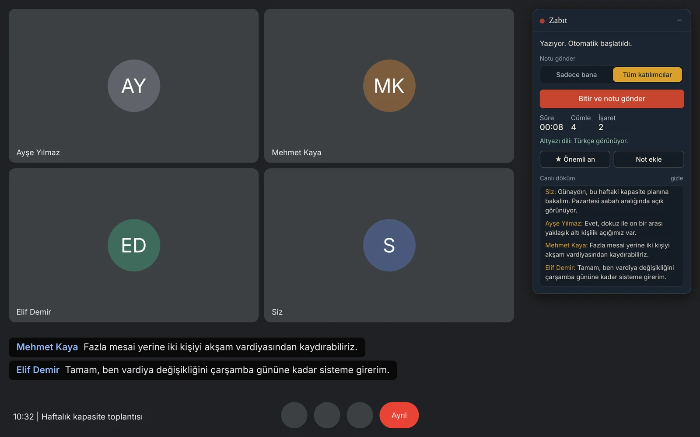

  

<h1 align="center">Zabıt</h1>

  Türkçe Google Meet toplantılarının zabıt kâtibi: otomatik döküm ve not. 
  <a href="https://segelferd.github.io/zabit/">Tanıtım sayfası</a> ·
  <a href="https://segelferd.github.io/zabit/gizlilik.html">Gizlilik politikası</a>

  

> Eski adı: Kâtip

## Nedir

Zabıt, Google Meet'in sizin ekranınızda gösterdiği altyazıyı konuşmacı ve saatle birlikte yazıya döken bir Chrome eklentisidir. Toplantıdan ayrıldığınızda dökümü Google Drive'ınıza Google Doküman olarak kaydeder, size ya da takvim davetindeki tüm katılımcılara e-postayla gönderir ve tek tıkla Gemini'ye aktarır.

Meet'in kendi not alma özelliği Türkçe toplantıları desteklemediği için yapıldı.

## Özellikler

| | |
|---|---|
| **Canlı döküm** | Konuşmacı adı ve saatle birlikte, kartta anlık |
| **Kendiliğinden biter** | Görüşmeden ayrılınca not otomatik bitirilir ve gönderilir |
| **Otomatik başlatma** | İsteğe bağlı; kapalıysa 2 dakika sonra hatırlatma |
| **Önemli an ve not** | Tek tıkla işaret, kendi notunuz dökümde zamanıyla |
| **Alıcı seçimi** | Sadece bana ya da tüm katılımcılar; seçim kalıcı |
| **Gemini'de aç** | 6 hazır komut: toplantı notu, aksiyon listesi, katılımcı özeti, karar kaydı, riskler, konuşmacı bazlı taahhütler |
| **Toplantı listesi** | Son 20 toplantı; sonradan yeniden gönderme |
| **Dil göstergesi** | Altyazı Türkçe değilse uyarı |
| **Yerel mod** | Apps Script erişimi olmayan hesaplarda gönderimsiz çalışma |

## Gizlilik

- Toplantıya bot eklenmez, ses kaydı alınmaz.
- Üçüncü taraf sunucu yoktur; veri yalnızca Google hizmetlerinde ve kullanıcının kendi hesabı altında işlenir.
- Kullanıcı başlatmadan (ya da otomatik başlatmayı açmadan) hiçbir şey toplanmaz.

Ayrıntılar: [gizlilik politikası](https://segelferd.github.io/zabit/gizlilik.html)

## Erişim

Zabıt kurum içi kullanım için hazırlanmıştır. Chrome Web Store'da listelenmez, yalnızca ekibe iletilen bağlantıyla kurulur. Döküm servisi yalnızca kurum hesaplarına açıktır. Bu depo yalnızca tanıtım ve gizlilik sayfalarını içerir; eklentinin kaynak kodu burada yayınlanmaz.

## İletişim

semih.kalaycioglu@outlook.com

---

Zabıt, Google'a ait değildir ve Google tarafından onaylanmamıştır. Google Meet, Google Drive ve Gemini Google LLC'nin markalarıdır.
